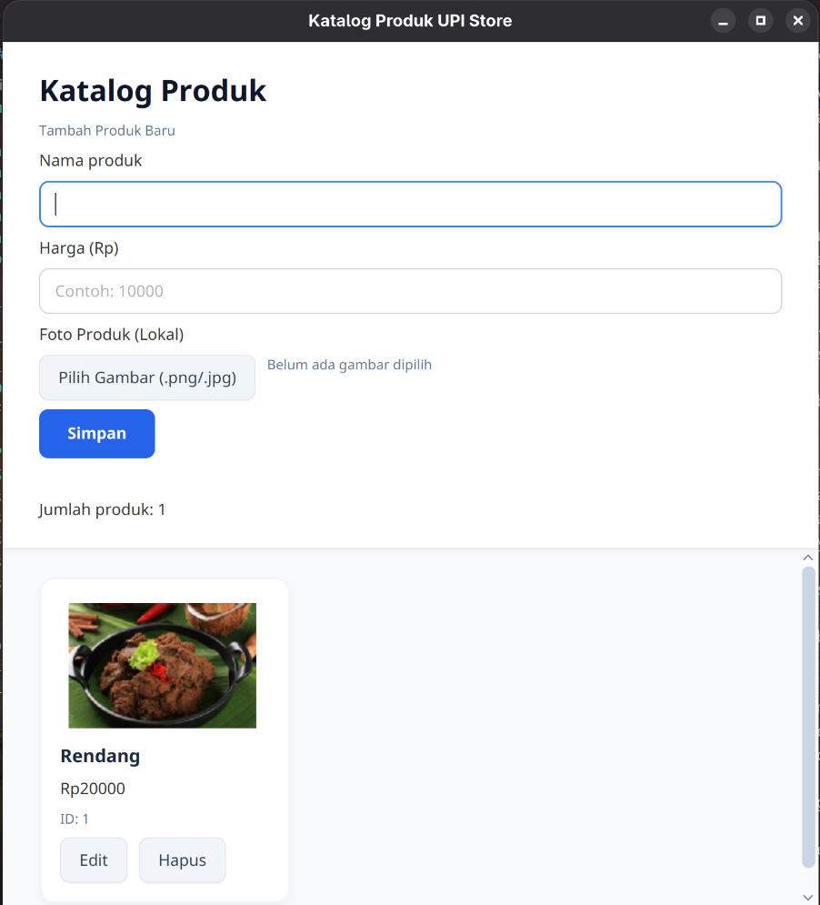
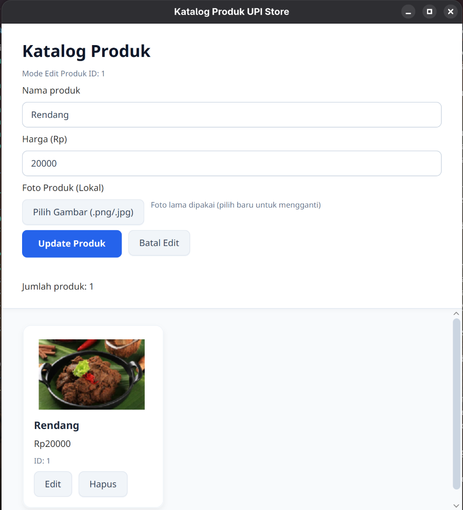
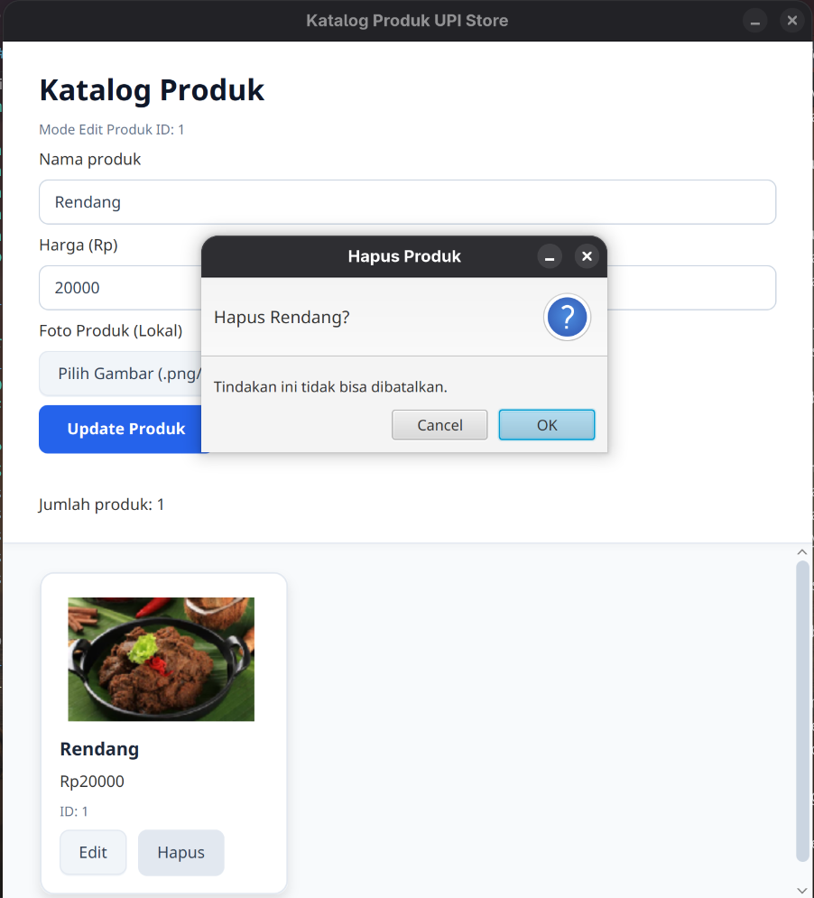

# Katalog Produk App

Katalog Produk adalah aplikasi desktop untuk pencatatan barang sederhana yang dibangun dengan **JavaFX** dan **SQLite**. Aplikasi ini menerapkan pola arsitektur **Model-View-Controller (MVC)** dan mendukung operasi CRUD (Create, Read, Update, Delete) secara lengkap, termasuk unggah foto produk dari penyimpanan lokal.

## Fitur

- **Tambah Produk:** Menambahkan data produk baru beserta foto dari file lokal.
- **Edit Produk:** Mengubah data produk yang sudah ada, meliputi nama, harga, dan foto.
- **Hapus Produk:** Menghapus produk dari database dengan dialog konfirmasi untuk mencegah penghapusan yang tidak disengaja.
- **Unggah Foto Lokal:** Memilih file `.png`, `.jpg`, atau `.jpeg` langsung dari komputer melalui `FileChooser` JavaFX, tanpa perlu mengetik path file secara manual.
- **Penyimpanan Lokal:** Data disimpan otomatis dalam database SQLite (`katalog.db`).

## Tangkapan Layar

| Tambah Produk | Edit Produk | Konfirmasi Hapus |
|:---:|:---:|:---:|
|  |  |  |

## Teknologi

- Java dengan JavaFX untuk antarmuka pengguna
- SQLite sebagai basis data lokal
- Apache Maven untuk manajemen dependensi dan build
- Arsitektur MVC

## Prasyarat

Pastikan perangkat Anda sudah terpasang:

1. **Java Development Kit (JDK) 17** atau versi yang lebih baru
2. **Apache Maven**

## Instalasi dan Menjalankan Aplikasi

1. **Clone repositori**

   ```bash
   git clone https://github.com/egiyudasebayang-collab/Katalog-Produk.git
   ```

2. **Masuk ke direktori proyek**

   ```bash
   cd Katalog-Produk
   ```

3. **Jalankan aplikasi menggunakan Maven**

   ```bash
   mvn clean javafx:run
   ```

Setelah perintah di atas dijalankan, jendela aplikasi Katalog Produk UPI Store akan terbuka secara otomatis.
